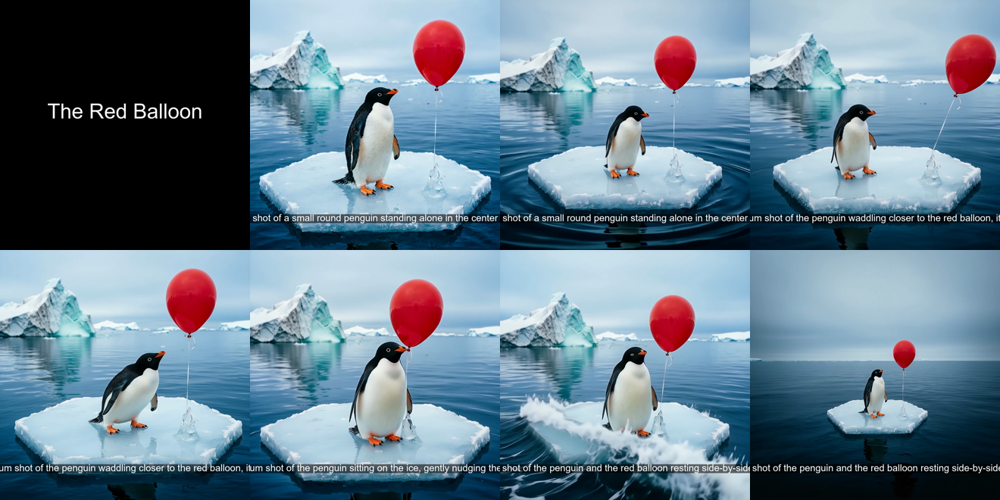

# Continuity: an AI showrunner for consistent short films

[](https://github.com/ssh071102-code/continuity-showrunner/actions/workflows/ci.yml)
[](LICENSE)

Continuity turns a one-line premise into a short film and keeps the same character, costume and set in every shot.



*Frames sampled from the v4 film (`src.chain`). The finished film is attached to the [latest GitHub Release](https://github.com/ssh071102-code/continuity-showrunner/releases/latest).*

Built for the Qwen Cloud Global AI Hackathon, Track 2 (AI Showrunner).

## Quickstart

No API key is needed for the tests or the CLI help:

```bash
git clone https://github.com/ssh071102-code/continuity-showrunner.git
cd continuity-showrunner
pip install -r requirements-dev.txt
# Linux only: the ffmpeg bundled with imageio-ffmpeg lacks drawtext, which the
# title/caption test needs. Use the distro ffmpeg instead (CI does the same).
sudo apt-get update && sudo apt-get install -y ffmpeg && export IMAGEIO_FFMPEG_EXE=/usr/bin/ffmpeg
python -m pytest tests          # offline: assembly tests + chain QA tests, no network
python -m src.run --help        # CLI options for the per-shot runner
```

On Windows the bundled ffmpeg already has `drawtext`, so skip the Linux line. macOS is untested; if the title test fails there, point `IMAGEIO_FFMPEG_EXE` at a full ffmpeg (for example `brew install ffmpeg`).

To generate a film you need a Qwen Cloud key (https://home.qwencloud.com/api-keys).
Copy `secrets/.env.example` to `secrets/.env` and set `DASHSCOPE_API_KEY=sk-...`. Generation calls paid image and video models.

```bash
# v4, the method shown above: segment chaining with a vision QA gate
python -m src.chain "A lonely penguin on an ice floe befriends a lost red balloon."

# v3: one keyframe per shot, anchored on shot 1, plus title card / captions / crossfades
python -m src.run "A lonely penguin on an ice floe befriends a lost red balloon." --dry-run
python -m src.run "..." --limit 2 --keyframes-only     # cheapest partial run
python -m src.run "..." --captions                    # full film
```

Output lands in `outputs/` (gitignored): `film_chained.mp4` from `src.chain`, `film.mp4` from `src.run`.

## What the pipeline does

1. The planner (`src/showrunner.py`) asks Qwen for a JSON plan: title, logline, visual style, a consistency contract (character, costume, location, palette, camera) and 4 to 6 shots.
2. Code injects the same contract into every shot prompt, so the model never has to remember the character across shots.
3. Keyframes are generated with `qwen-image-2.0` and `qwen-image-edit`; clips with `wan2.7-i2v`.
4. `src/stitch.py` assembles the clips with the bundled ffmpeg from `imageio-ffmpeg`.

### Two entry points

| Command | Method | How shots are made |
|---|---|---|
| `python -m src.chain` | v4, segment chaining | Character sheet, then K0 opening frame, then one end-beat keyframe per segment (edited from K0). Each segment's first frame is the real last frame of the previous clip, and its last frame is the next beat keyframe. A `qwen3-vl-plus` check compares every keyframe and tail against the character sheet. |
| `python -m src.run` | v3, anchored shots | Shot 1's keyframe is generated from text; later keyframes are edited from it. Each shot is animated independently from its keyframe. Adds title card, captions, crossfades and `--limit` / `--keyframes-only` / `--dry-run` for cheap runs. |

The v4 film and the gallery grid above came from `src.chain`.

### QA gate and stop-loss (`src.chain`)

Each K0, beat keyframe and segment tail goes through a vision check. A failed keyframe gets one retry; a second failure, or any failed segment tail, stops the run so no more segments are paid for on a broken chain.

If the QA call cannot return a verdict (network error after retries, non-200 response, or a reply whose `same_character` and `artifacts` fields are not both JSON booleans), the check is logged as `qa_unavailable` and counts as a fail. Set `CHAIN_QA_FAIL_OPEN=1` to let those cases pass instead.

## Consistency across versions (judged by eye)

| v1 text contract | v2 pixel anchor |
|---|---|
|  |  |

| v3 framing rule | v4 segment chaining |
|---|---|
|  |  |

**v1, text-only contract.** 3 of 4 shots held. Shot 3 changed background (icebergs to rocky mountains), framing and face. A text description did not pin the visual identity.

**v2, pixel anchoring.** The environment held in 4 of 4 shots; the crack pattern on the ice floe is identical in every shot. The character held in 3 of 4: the one close-up re-rendered the face at a different scale and its markings drifted.

**v3, anchoring plus a framing rule.** The planner now keeps every shot medium or wide. Environment and framing held in 5 of 5; fine features (crest, belly patch) still faded across edits.

**v4, segment chaining (`src/chain.py`).** Joins are continuous because each segment starts from the previous segment's real last frame. In the sampled frames the character and set stay the same throughout, and no identity break was visible.

These are visual judgements on single runs, not a benchmark.

## Layout

```
src/chain.py        v4 chained director (python -m src.chain)
src/run.py          v3 runner with assembly options (python -m src.run)
src/showrunner.py   planner: premise -> plan -> per-shot prompts; v3 make_film
src/media.py        image, image-edit, image-to-video and upload helpers
src/qwen.py         Qwen Cloud chat client, loads secrets/.env
src/stitch.py       ffmpeg assembly: title card, captions, crossfades, music
tests/              offline tests (no key, no network)
docs/grids/         sampled-frame grids per version
NOTES-qwen-api.md   API notes for the Qwen Cloud endpoints used here
secrets/            API key template; the real key is gitignored
outputs/            generated frames, clips and films (gitignored)
```

## Status

- [x] D1: scaffold and smoke calls for text, image (`qwen-image-2.0`) and video (`wan2.7-i2v`). See `NOTES-qwen-api.md`.
- [x] D2: script and storyboard agent with the consistency contract injected per shot.
- [x] D3: first end-to-end film, *"The Red Drift"*: 4 keyframes, 4 clips, stitched, 20.2 s at 1440×1440.
- [x] D4: reference-anchored keyframes via `qwen-image-edit`.
- [x] D5: public repo. The v4 film is distributed as a GitHub Release attachment.

## Limitations

- Generation needs a paid Qwen Cloud key; only the tests and `--help` run without one.
- The offline tests cover assembly and the QA gate logic. The generation path itself is not tested in CI.
- The consistency results above are single runs judged by eye.
- `src.chain` has no `--limit` or `--dry-run`; use `src.run` for cheap partial runs.
- QA became fail-closed after the v4 film was made. Before that change, a QA call that returned no verdict counted as a pass.
- Beat keyframe prompts in `src.chain` still ask for a photorealistic look, so non-photographic plan styles are not supported there yet.
- The Linux build of ffmpeg bundled with imageio-ffmpeg has no `drawtext` filter, so title cards and captions are skipped. Point `IMAGEIO_FFMPEG_EXE` at a full system ffmpeg (for example `/usr/bin/ffmpeg`); CI does this.

## Credits

- [@ssh071102-code](https://github.com/ssh071102-code): generation pipeline, consistency system, chain director
- [@zihanshen41-pixel](https://github.com/zihanshen41-pixel): demo-grade assembly (title card, captions, crossfades), hardened runner and tests

## Related

[script2video](https://github.com/ssh071102-code/script2video) handles the deterministic side of the same problem: it turns a written script into narration with word-timed captions and assembles the video with ffmpeg.

## License

MIT, see [LICENSE](LICENSE).
